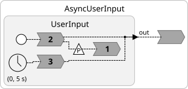
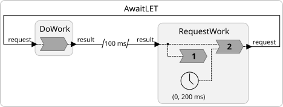

A reaction in Lingua Franca runs to completion at a single tag; it is "logically instantaneous," meaning that logical time does not elapse during the execution of the reaction. This helps make LF programs deterministic, but it also means that a reaction body cannot *wait* for anything. If it blocks on a socket, a keyboard, or a slow library call, the whole program stalls. And if it needs a result that some other reactor will produce at a later tag, the reaction has to end and a second reaction has to pick up where it left off. Two new functions, `lf_async` and `lf_await`, remove this restriction in the C and Python targets. A reaction can now suspend in the middle of its body, let logical time advance and other reactions run, and continue later at a well-defined tag, with its local variables intact.

{/* truncate */}

## The Problem

Suppose a reactor needs to read a line of text typed by a user. The obvious C code is a call to `getline`, which blocks until the user presses return. Putting that call in a reaction is a disaster: logical time cannot advance while the reaction is executing, so every timer, every input, and every other reactor in the program freezes until the user types something. A Python reaction that calls `input()` stalls the program in the same way.

The standard LF workaround has been to spawn a thread. The thread does the blocking call and then schedules a physical action, and a reaction triggered by that action picks up the result:

```lf-c
reactor UserInput {
  physical action line: char*
  output out: char*

  reaction(startup) -> line {=
    lf_thread_create(&self->thread, &read_lines, line);  // Thread calls lf_schedule(line, ...)
  =}

  reaction(line) -> out {=
    lf_set(out, line->value);
  =}
}
```

This works, but the logic of the program is now spread across a thread, a physical action, and two reactions, and anything the second reaction needs from the first has to be stashed in state variables. Programmers who have written callback-based code know this pattern well, and know the name for what it does to a program: **stack ripping**.

The problem is not limited to blocking I/O. A reaction that sends a request to another reactor and needs the answer faces the same thing. The answer may arrive at a later tag, so a different reaction must receive it, and again everything of interest has to be copied into state. Languages such as JavaScript, Python, C#, and Rust solved this with `async`/`await`, which lets a function pause at an `await` and resume when the thing it is waiting for is ready, without the programmer having to split the function. Lingua Franca now has an analogous mechanism, but with a twist that fits the LF model of time: a suspended reaction does not just resume *eventually*, it resumes at a specific *tag*. This makes the mechanism much more deterministic than those in other languages.

## `lf_async`: Suspend Around a Blocking Call

Here is the user-input example, written with `lf_async`:

```lf-c
reactor UserInput {
  preamble {=
    // Read a line from stdin into malloc'd memory. Returns 0 on EOF.
    size_t read_string(char** result) { ... }
  =}
  timer t(0, 5 s)
  output out: char*
  state count: int
  physical action awake

  reaction(awake) {=
    lf_async_resume(awake);
  =}

  reaction(startup) -> out, awake {=
    while (true) {
      char* line = NULL;
      int nread = lf_async(awake, read_string, &line);
      if (nread == 0) {
        lf_request_stop();
        break;
      }
      // The logical time is now the physical time at which the line was read.
      lf_set(out, line);
    }
  =}

  reaction(t) -> out {=
    char* prompt = NULL;
    asprintf(&prompt, "%d: Waiting for input...", self->count++);
    lf_set(out, prompt);
  =}
}
```



The key line is

```c
int nread = lf_async(awake, read_string, &line);
```

This calls `read_string(&line)` and returns its result, just as a direct call would. But while `read_string` is blocked waiting for the user, the rest of the program keeps running: the timer reaction prints a prompt every five seconds, and any other reactors in the program proceed normally. When `read_string` returns, the physical action `awake` is scheduled at the current physical time, the reaction triggered by `awake` runs and calls `lf_async_resume(awake)`, and the `startup` reaction continues from the line after `lf_async`, now at the tag of the physical action. The `while` loop is an ordinary loop; the local variable `line` survives the suspension; and no state variables are involved.

A session looks like this:

```
At logical time 0, Line: 0: Waiting for input...
hello
At logical time 2314876000, Line: hello
At logical time 5000000000, Line: 1: Waiting for input...
world
At logical time 7102351000, Line: world
```

Each line of input is produced at the logical time equal to the physical time at which the user typed it, which is exactly what you want from a program that reads real-world input.

Two conventions make this work. The action passed to `lf_async` is listed as an *effect* of the calling reaction (so that it is in scope), and the reaction that calls `lf_async_resume` on that action is declared *before* the reaction that calls `lf_async`. The second rule is what lets the suspended reaction resume *after* the resuming reaction completes at the same tag, so that the reaction continues at a tag that has a precise meaning.

### The Python target

The Python target provides the same operations as methods of the reactor. The function passed to `lf_async` is an ordinary Python function, not a coroutine, and the reaction that calls it is an ordinary function too:

```lf-py
preamble {=
    def read_string():
        """Read a line from the keyboard. Return None on EOF."""
        try:
            return input()
        except EOFError:
            return None
=}

reactor UserInput {
  timer t(0, 5 s)
  output out
  state count = 0
  physical action awake

  reaction(awake) {=
    self.lf_async_resume(awake)
  =}

  reaction(startup) -> out, awake {=
    while True:
        line = self.lf_async(awake, read_string)
        if line is None:
            request_stop()
            break
        # The logical time is now the physical time at which the line was read.
        out.set(line)
  =}

  reaction(t) -> out {=
    out.set(f"{self.count}: Waiting for input...")
    self.count += 1
  =}
}
```

`self.lf_async(awake, read_string)` calls `read_string()` and returns whatever it returns. While `input()` is blocked, the prompt reaction still runs, and the logical time after the call is again the physical time at which the line was typed. Further arguments are passed through to the callable, so `self.lf_async(awake, slow, 50)` calls `slow(50)`.

The methods are on `self` because the runtime needs the reactor that is executing the reaction. The C functions hide that argument inside a macro. Define the callable in a file-level preamble, as above, so that it is a plain function. A function defined in a reactor preamble becomes a method of the generated class and is passed as `self.read_string`.

This is not Python's `async`/`await`. The call does not yield to `asyncio`, and the reaction does not have to be declared `async`. It blocks the worker thread, just as the C version does.

### Giving a blocking call a logical duration

The action passed to `lf_async` need not be physical. If it is a **logical action** with a minimum delay, it is scheduled when `lf_async` is *called*, not when the function returns:

```lf-c
logical action done(200 ms)

reaction(done) {=
  lf_async_resume(done);
=}

reaction(startup) -> done {=
  int result = lf_async(done, slow_computation, 42);
  // Logical time is now exactly 200 ms, however long slow_computation() took.
=}
```

In Python, the same program is:

```lf-py
logical action done(200 ms)

reaction(done) {=
  self.lf_async_resume(done)
=}

reaction(startup) -> done {=
  result = self.lf_async(done, slow_computation, 42)
  # Logical time is now exactly 200 ms, however long slow_computation() took.
=}
```

If `slow_computation` finishes early, the reaction continues at 200 ms anyway. If it is still running when logical time reaches 200 ms, the resuming reaction blocks until it returns, holding logical time at 200 ms. Either way, the rest of the program sees the result at exactly 200 ms. This gives the blocking call a deterministic logical duration, independent of how long it actually takes, which is often what a time-sensitive design needs.

## `lf_await`: Suspend Until an Input Arrives

The second function, `lf_await`, does not call anything. It simply suspends the reaction until another reaction of the same reactor calls `lf_await_resume` on the same input port. The natural use is request-response:

```lf-c
reactor RequestWork {
  input result: int
  output request: int
  timer t(0, 200 ms)
  state count: int = 1

  reaction(result) {=
    lf_await_resume(result);
  =}

  reaction(t) result -> request {=
    lf_print("Request work at logical time " PRINTF_TIME, lf_time_logical_elapsed());
    lf_set(request, self->count++);
    lf_await(result);
    lf_print("Result %d received at logical time " PRINTF_TIME, result->value, lf_time_logical_elapsed());
  =}
}

reactor DoWork {
  input request: int
  output result: int

  reaction(request) -> result {=
    lf_set(result, request->value * 2);
  =}
}

main reactor {
  request_work = new RequestWork()
  process_work = new DoWork()
  request_work.request -> process_work.request
  process_work.result -> request_work.result after 100 ms
}
```



The timer reaction sets the `request` output, then calls `lf_await(result)`. The output is delivered at the tag of the timer, `DoWork` responds at that same tag, and the `after 100 ms` on the feedback connection delivers the result 100 ms later. At that tag, the reaction triggered by `result` runs first and calls `lf_await_resume(result)`, and the suspended reaction continues:

```
Request work at logical time 0
Result 2 received at logical time 100000000
Request work at logical time 200000000
Result 4 received at logical time 300000000
...
```

Notice the port `result` listed between the triggers and the `->` in the second reaction. It is a *source*, not a trigger: the reaction is not triggered by `result`, but `result` is in scope in its body, both to pass to `lf_await` and to read `result->value` afterwards.

The Python version has the same structure. Ports are read with `.value`, outputs are written with `.set`, and the calls are methods:

```lf-py
reactor RequestWork {
  input result
  output request
  timer t(0, 200 ms)
  state count = 1

  reaction(result) {=
    self.lf_await_resume(result)
  =}

  reaction(t) result -> request {=
    print(f"Request work at logical time {lf.time.logical_elapsed()}")
    request.set(self.count)
    self.count += 1
    self.lf_await(result)
    print(f"Result {result.value} received at logical time {lf.time.logical_elapsed()}")
  =}
}

reactor DoWork {
  input request
  output result

  reaction(request) -> result {=
    result.set(request.value * 2)
  =}
}
```

When `self.lf_await(result)` returns, `result.value` is the value that arrived at the new tag.

What this example implements is a **logical execution time** (LET) pattern. From the perspective of `RequestWork`, `DoWork` behaves like a function call that takes exactly 100 ms of logical time, no matter how long the computation in `DoWork` actually takes. If several reactions of a reactor are waiting on the same port, a single `lf_await_resume` on that port resumes all of them.

## What Happens Under the Hood

In most languages, `async`/`await` is implemented by turning the function into a state machine or coroutine. LF's version takes a different route, because reactions in the C target are ordinary C functions, and reactions in the Python target are ordinary Python functions, executed by a pool of worker threads.

When a reaction calls `lf_async` or `lf_await`, the runtime first propagates any outputs the reaction has already set, so that downstream reactions see them at the current tag. Then the worker thread executing the reaction *leaves the pool*. If no spare thread is available, a new worker thread is created to take its place. From the scheduler's point of view, the reaction has finished: the remaining workers advance logical time and execute other reactions exactly as they would have. The departed thread sits on the stack of the suspended reaction, either blocked in the user's function or waiting to be resumed.

When the resuming reaction calls `lf_async_resume` or `lf_await_resume`, the suspended thread rejoins the pool and continues the reaction, at the current tag, once the resuming reaction has completed. Threads created this way persist for the rest of the run, so the cost is one extra thread per concurrently suspended reaction, not per call. A reaction that loops over `lf_async`, like `UserInput` above, reuses a single added thread.

A consequence of this design is that it works with any C function, unmodified, and with any Python function. There is no need for a special asynchronous API, no coloring of functions into "async" and "sync" variants, and no requirement that the blocking call cooperate.

The Python methods call that same C runtime. Around the parts of the call that can block inside the runtime, the binding releases Python's global interpreter lock, so the worker that runs the resuming reaction can execute Python code. The function passed to `self.lf_async` runs with the lock held. Blocking calls in the Python standard library, such as `input()` and `time.sleep`, release the lock themselves. A long stretch of pure Python does not, and other Python reactions wait until it returns.

## Determinism

What distinguishes this from simply running a thread is that the point at which the reaction continues is a *tag*, chosen by the program, not by the operating system scheduler. With a logical action, that tag is fully determined by the program. With a physical action, the tag reflects the physical time at which the call returned, which is the right answer when the program is reacting to the outside world. With `lf_await`, it is the tag at which the awaited input arrives.

Either way, once the reaction continues, the rest of the program sees its outputs at that tag and nowhere else. Other reactions of the same reactor are mutually exclusive with the suspended one, so there are no data races on state variables, although their values may well have changed by the time the reaction continues. And if the program stops before a resume happens, the suspended call returns at the stop tag, after shutdown reactions have run, so the reaction completes rather than being abandoned.

## Trying It Out

`lf_async` and `lf_await` are available in the C and Python targets of the current development version of Lingua Franca, with the threaded runtime and the default scheduler. The examples above are in the [C](https://github.com/lf-lang/playground-lingua-franca/tree/main/examples/C/src/async-await) and [Python](https://github.com/lf-lang/playground-lingua-franca/tree/main/examples/Python/src/async-await) collections of the [LF playground repo](https://github.com/lf-lang/playground-lingua-franca/tree/main), and the full set of rules and caveats is in the handbook page on [Async and Await](/docs/next/writing-reactors/async-await).
